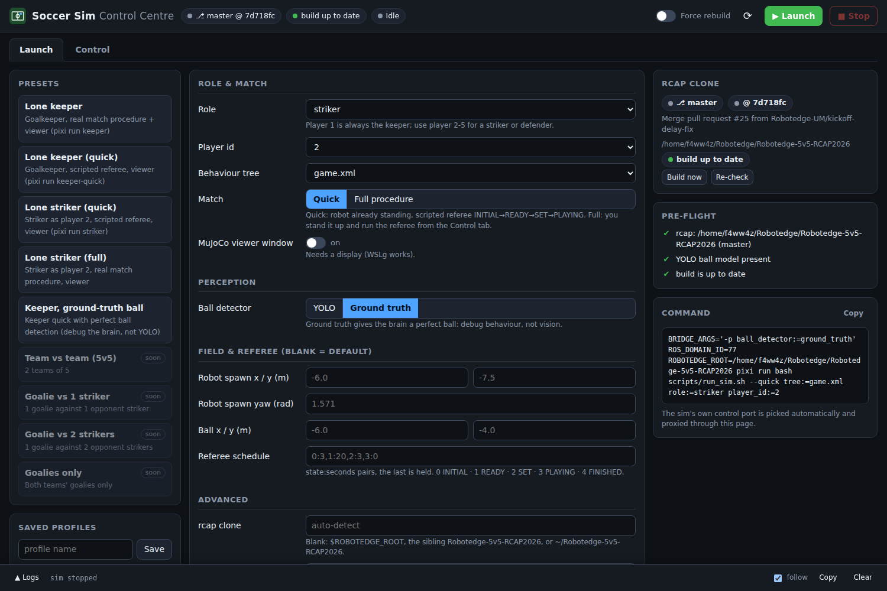
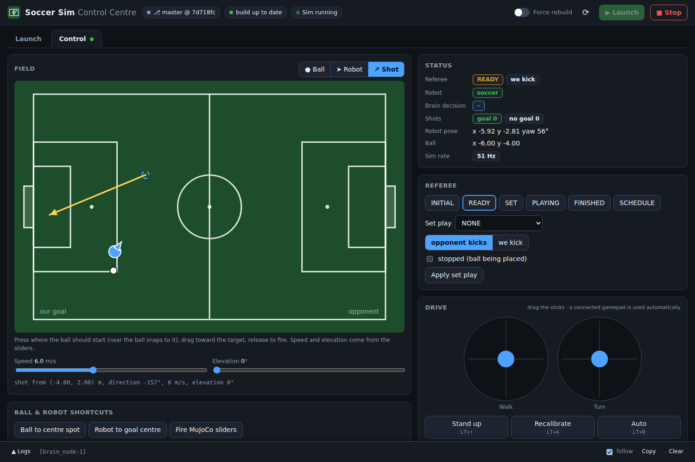

# soccerSim

A desktop simulator for testing **Robotedge's soccer brain** (`brain_node` from
[Robotedge-5v5-RCAP2026](https://github.com/Robotedge-UM/Robotedge-5v5-RCAP2026)) without a robot.

It runs the team's real, unmodified `brain_node` against a simulated Booster T2 on a RoboCup field
(MuJoCo; Linux/WSL2 or macOS). Brain gets the same ROS topics and RPCs it gets on the robot, so it can't tell the
difference. You can try a behaviour-tree or strategy change on your laptop, fire shots at the keeper,
run set plays and watch what the robot decides, all before taking it to the field.

| 6 m/s shot to the corner | 4 m/s shot from wide, to the near post |
|---|---|
|  |  |

The goalkeeper brain at work. The text along the top is brain's live decision (`retreat`, then
`save` once it judges the shot is coming at goal), the walk command it sends, and the ball's speed. (Recorded headless with `SIM_VY_MAX=1.7`.)

## What it is (and isn't)

The goal is **testing brain logic**: decisions, positioning and timing under believable conditions.
The physics is only as realistic as that needs.

| Part | How it's simulated | How close to the robot |
|---|---|---|
| Walking | Booster's own trained T2 walk policy (`t2_walk` weights from `booster_deploy`) on Booster's T2 model and PD gains | Close: it's the same policy, so it lags, overshoots and turns like the real gait |
| Kick | A stand-in that pushes the ball when brain asks for a visual kick | Rough: Booster's RL kick isn't public |
| Getting up, falling | Get-up teleports the robot upright; damping and prepare modes just stop it | Not simulated |
| Head camera | Rendered from the team's calibration (`vision.yaml`), RGB and depth | Same pose and intrinsics |
| Ball detection | A real YOLOv8 model run on the rendered frames | Realistic misses and range errors, but it's Booster's public model, not ours |
| Posts, field lines, markings | Ground truth projected through the camera | Perfect: no occlusion or false detections |
| Localisation, odometry | Brain's own localisation runs on the simulated detections; odometry is ground truth from the spawn point | Brain's code, cleaner inputs |
| Referee, gamepad | GameController messages and remote-controller state, sent from a browser tab | Same messages brain reads |


*What brain sees: a head-camera frame as rendered for the YOLO ball detector.*

Use it to check **what brain decides and where it goes**. Don't use it to tune walking speeds, kick
power, or anything that depends on the vision model's exact numbers.

## How it fits together

```
 Robotedge-5v5-RCAP2026 (your clone, read-only)           soccerSim
 ┌───────────────────────────────┐  copied + built   ┌──────────────────────────────────────┐
 │ src/brain (behaviour trees,   │ ───────────────▶  │ ros_ws/src/brain → brain_node        │
 │   config.yaml, C++)           │                   │        ▲  ROS 2 topics + loco RPC    │
 │ src/vision/config/vision.yaml │ ─ camera calib ─▶ │        ▼                             │
 │ src/*_msgs, *_interface       │ ── symlinked ──▶  │ soccer_sim_bridge: stands in for the │
 └───────────────────────────────┘                   │   T2 SDK, camera, vision, referee    │
                                                     │        ▼                             │
                                                     │ soccer_sim: MuJoCo + T2 walk policy  │
                                                     │   + YOLO ball + kick stand-in        │
                                                     └──────────────────────────────────────┘
```

The sim never modifies the Robotedge repo. `pixi run build-sim` copies `src/brain` into this repo,
applies two small patches and builds it:

- `patches/brain-clang.patch`: 8 lines that clang needs and the robot's GCC doesn't. Behaviour is unchanged.
- `patches/brain-decision-topic.patch`: an observer-only publisher, `/brain/decision`, so the viewer
  overlay can show every decision change. Optional: if it stops applying the build warns and the
  overlay falls back to brain's rate-limited `/speak` announcements.

Brain runs with the Robotedge `config.yaml`, but with rerun logging and team UDP turned off.

## Requirements

- Linux x86-64 (verified on Ubuntu 24.04 under WSL2) or an Apple Silicon Mac. Both are in the pixi
  environment. Other architectures (Linux arm64) aren't covered.
- `git curl rsync patch unzip` (e.g. `sudo apt install git curl rsync patch unzip`; `setup.sh`
  tells you what is missing).
- A clone of the Robotedge repo. It's found at `$ROBOTEDGE_ROOT`, else in a sibling folder named
  `Robotedge-5v5-RCAP2026`, else at `~/Robotedge-5v5-RCAP2026`.

Everything else is downloaded by the setup: [pixi](https://pixi.sh) itself, ROS 2 Kilted, MuJoCo,
PyTorch and the compilers (into `.pixi/`, nothing system-wide), the Booster submodules, Booster's YOLOv8
ball model, the Booster SDK headers (from Booster's public
[booster_robotics_sdk](https://github.com/BoosterRobotics/booster_robotics_sdk) repo; set
`SDK_ZIP=/path/to/sdk_release.zip` to use your own copy instead) and the rerun C++ SDK.

## Setup (once)

```bash
git clone --recurse-submodules <this repo> soccerSim && cd soccerSim
bash scripts/setup.sh
```

That installs the environment (a few GB), builds brain and the bridge, and runs the unit tests. The
first build also compiles the rerun C++ SDK that brain links against, which takes several minutes.
It is safe to re-run. The individual steps are `pixi install`, `pixi run fetch-models`,
`pixi run build-sim` and `pixi run test`.

If the Robotedge repo lives somewhere else, `export ROBOTEDGE_ROOT=/path/to/Robotedge-5v5-RCAP2026`
before setup and before every run.

### Linux notes

- **The viewer runs in its own process on Linux**, fed the robot and ball poses by the sim. Rendering it inside
  the sim process made the two fight for the CPU and dropped the sim to about 30 Hz. Now it holds the
  50 Hz target with the viewer open. `--viewer` needs a display (X11 or Wayland). On WSL2, WSLg
  provides one and `DISPLAY=:0` is set for you if your shell hasn't.
- **The head camera renders offscreen through EGL**, so no display is needed without `--viewer`. On
  WSL2 it uses Mesa's software rasteriser (llvmpipe): the camera frame is small, and WSL's D3D12 driver
  stalls ~25 ms per frame reading it back, 5x slower than the CPU. The viewer window still uses your
  GPU. `SIM_CAMERA_GL=software` forces llvmpipe on any Linux (e.g. if EGL finds no usable GPU) and
  `SIM_CAMERA_GL=gpu` keeps the system driver. Export `MUJOCO_GL` to override the backend.

## Control Centre (web launcher + controller)

```bash
pixi run launch               # serves http://127.0.0.1:8765/ and opens it
pixi run launch --port 8800   # another port
pixi run launch --last        # no UI: build if needed, then run the last saved config
```

One page to **launch and drive** the sim. Leave `pixi run launch` running; the page stays up between sim runs.



**Launch tab.** Pick a preset or saved profile, or edit the form: role, player id, behaviour tree, quick vs
full match, viewer, ball detector, spawn/ball positions, referee schedule, `SIM_VY_MAX`, GL backends,
`ROS_DOMAIN_ID`, extra raw bridge/launch args. The side panel shows the rcap clone in use, the pre-flight
checks (with a *Fix* button where there is one) and the exact command. *Tools* run `build-sim`, `build-ws`,
`fetch-models`, the three test tasks and `scripts/setup.sh` with live output in the log drawer.

**Control tab** (switches on by itself once the sim answers).



- **Field map**: *Ball* tool, click to put the ball there. *Robot* tool, click to place the robot and drag to
  set its heading. *Shot* tool, press at the start point (near the ball snaps to it), drag to aim, release to
  fire; speed and elevation sliders. Live ball and robot markers. Field frame: our goal on the left, x towards
  the opponent.
- Everything the old controller page had: the two sticks and gamepad buttons (a connected gamepad is used
  automatically), Stand up / Recalibrate / Auto combos, referee states and set plays, 6 ball spots and the
  9 x 3 preset shots, reset buttons, and a rendered status panel (referee, robot mode, brain decision,
  shot tally, pose, sim rate).

How it works:

- **rcap is built from whatever the clone has checked out**, found like `scripts/activate.sh` does
  (`$ROBOTEDGE_ROOT`, the sibling `Robotedge-5v5-RCAP2026`, then `~/Robotedge-5v5-RCAP2026`, or the path
  in *Advanced*). The launcher never fetches or checks out. It fingerprints `src/brain`, the message
  packages and `patches/`, and runs the `build-sim` build only when that changed since the last
  successful build (or turn on *Force rebuild*).
- **Ports.** The launcher owns the port (8765). The sim's own controller server moves to an automatically
  chosen internal port and the launcher proxies it, so the page is always same-origin. If a previous
  launcher still holds the port, the new one stops it (and its sim) and takes over; if anything else holds
  it, the launcher says so and exits without touching it.
- **Saved state** is in `.launcher/state.json` (git-ignored): the last launched config, restored on the
  next start, and your named profiles. Unsaved form edits survive a page reload.
- The server only listens on 127.0.0.1, rejects foreign `Host`/`Origin` headers, and never uses a shell.
- `pixi run keeper`, `keeper-quick` and `striker` still work on their own, with the bridge's simpler
  controller page (below) on port 8765, when the launcher is not running.
- The team presets (5v5, goalie vs 1 or 2 strikers, goalies only) are listed as *soon*: the sim has one
  robot today, see [Known limitations](#known-limitations).

## Run

```bash
pixi run keeper-quick     # goalkeeper, skips the match procedure
pixi run keeper           # goalkeeper, full match procedure
pixi run striker          # striker (player 2), skips the match procedure
```

These are shortcuts for `pixi run bash scripts/run_sim.sh --viewer [--quick] role:=...`.
Then open the controller tab at **http://127.0.0.1:8765/**. Leave out `--viewer` to run without the
MuJoCo window.

The text along the top of the viewer is brain's live state:

| Row | Shows |
|---|---|
| brain decision | `find`, `retreat`, `save`, `chase`, ... as brain's behaviour tree decides it |
| walk command | the velocity brain asks the robot for (`vx`, `vy`, `yaw`), `[manual]` while the gamepad drives |
| ball speed | in m/s |
| robot mode | `soccer`, `prepare`, ... and `(kicking)` during a visual kick |
| referee | game state, set play and who kicks |
| brain said | brain's last spoken announcement (`game state PLAYING`, `camera lost`, ...) |
| shots | goal / no-goal tally and the last result |
| sim rate | achieved tick rate against the 50 Hz target |

- **By default the sim follows the real match procedure.** The robot boots in prepare mode at the
  sideline. In the controller tab, press **Stand up (LT+Up)**, **Recalibrate (LT+A)**, then
  **Auto (LT+B)**. Then press **READY**, **SET** and **PLAYING** in the referee panel.
- **`--quick` skips that procedure.** The robot starts in soccer mode, and the referee runs
  INITIAL (3 s), READY (20 s) and SET (3 s), then PLAYING, by itself.
- **A striker needs `player_id:=2`.** Brain makes player `game.initial_goalkeeper_id` (1) the
  keeper whatever `role:=` says, and the robot is player 1 by default.
- **Other launch arguments:** `tree:=<file in src/brain/behavior_trees>`. The default is `game.xml`.

### Testing from the controller tab


- **Reset ball to centre spot** and **Reset robot to goal centre**.
- **Place ball (in keeper's view)** puts a stationary ball where the keeper can see it, so it
  doesn't sit in find mode.
- **Preset shots** at our goal from several angles, grouped by speed (4, 6 and 8 m/s).
- **Shoot** fires with the MuJoCo window's shot slider values (origin, speed, direction, elevation).
- **Referee panel:** game states and set plays. Pick the set play, who kicks and whether play is
  stopped, then press Apply.
- **Virtual gamepad.** A physical gamepad works too. The sticks drive the robot directly, like the
  firmware remote.
- **Live status**, including a goal / no-goal tally for shots.

You can also fire shots from a script. Results appear on `/sim/shot_result`.

```bash
# data: x, y, speed (m/s), direction (deg), elevation (deg)
ros2 topic pub --once /sim/shoot std_msgs/Float64MultiArray "{data: [-7.0, 1.0, 5.0, 190.0, 0.0]}"
```

The MuJoCo window has the same shot launcher, as sliders in its Control panel (top right). A
direction of 180° is straight at our goal. Drag `shot_fire` right to shoot, then back left to re-arm.

### Field coordinates

Positions use brain's field frame: our goal line is at x = −11, the goalposts are at y = ±1.3 and
the centre spot is (0, 0). +x points toward the opponent's goal.

## Workflow: change brain, test, repeat

1. Edit brain in your Robotedge clone (behaviour trees, `config.yaml`, C++), on any branch.
2. Run `pixi run build-sim`. It copies brain and rebuilds it.
3. Run the sim again and test.

Config-only changes (`config.yaml`, behaviour-tree XML) also need `build-sim`, because brain runs
from its copy in this repo.

If `build-sim` says `patches/brain-clang.patch no longer applies`, someone has changed one of the
8 patched lines in brain. Make the same change by hand (give the `rclcpp::Time` members an
initialiser, change `bind` to `::bind`), then refresh the patch.

If the team recalibrates the camera, `tests/test_field.py::test_camera_defaults_match_team_vision_yaml`
fails until `CameraCfg` in `soccer_sim/config.py` is updated to match.

## Settings

| Setting | How to change it | Default |
|---|---|---|
| Ball detection from ground truth instead of YOLO | `BRIDGE_ARGS='-p ball_detector:=ground_truth'` | YOLO |
| Lateral walk speed limit | `SIM_VY_MAX=1.2` | 0.8 m/s |
| Noise on posts and lines | `detection_noise_std` in `SimConfig` (`soccer_sim/config.py`) | 0 |
| Kick strength and shape | `KickParams` in `soccer_sim/kick_model.py` | — |

Put environment variables in front of the run command, for example
`SIM_VY_MAX=1.2 pixi run bash scripts/run_sim.sh --viewer role:=goal_keeper`.

## Tests

```bash
pixi run test        # fast unit tests
pixi run test-slow   # physics and rendering (steps MuJoCo for several seconds)
pixi run test-ros    # bridge tests: needs build-sim, and no other sim on the same ROS_DOMAIN_ID
```

## Known limitations

- **The sim is only real time if the machine keeps up.** Brain uses the wall clock, so a sim below
  50 Hz makes the ball look slower to brain than the shot you fired. On Linux/WSL2 it holds 50 Hz with
  the viewer open. On a Mac the viewer shares the sim's process and can slow it to about half speed;
  run without `--viewer` when timing matters.
- If the sim logs `sim ticking at N Hz (target 50)`, something else is using the CPU. The overlay's
  sim rate shows the same number.
- On Linux the viewer is a separate process that replays the sim's state. The shot sliders and
  Ctrl+right-drag on the robot or ball are passed back to the sim, but the viewer's Backspace reset and
  the physics options in its right panel only change the viewer's own copy.
- The kick is an approximation (`soccer_sim/kick_model.py`), not Booster's policy.
- The ball is detected by Booster's public sim-trained YOLOv8, not the team's own model, which only
  runs on the Jetson with TensorRT.
- Goalposts, markings and lines come from ground truth unless you add noise.
- There's only one robot. There are no teammates or opponents (shots come from the launcher), and
  team UDP is off.
- Ball rolling friction and the kick's power-to-speed mapping are guesses, not calibrated values.
- Camera frames render without shadows or reflections, to keep the sim fast.

## Licence and third-party code

soccerSim's own code is MIT-licensed (see `LICENSE`). The parts below aren't covered by that.


- `vendor/booster_deploy` and `vendor/booster_assets` are Booster Robotics' public repos. They're
  included as git submodules, under their own licences.
- `pixi run fetch-models` downloads the YOLOv8 ball model from Booster's public `robocup_demo` repo;
  it isn't committed here. Ultralytics weights are AGPL-3.0, so don't ship them in anything you
  distribute.
- The Booster SDK headers come from your own `sdk_release.zip` and aren't committed here.
